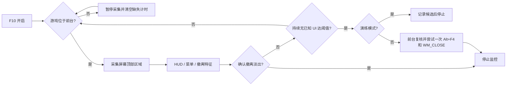

<div align="center">
  
  <h1>ID486 模拟助手 V0.23</h1>
  <p><b>RETURN BY DEATH / TARKOV</b></p>
  <p>面向本地 PvE 战局的 Windows 视觉监控实验工具</p>
  
  
  
  <p>仅用于本地战局模拟大退 · 禁止线上使用</p>
</div>

---

通过屏幕顶部的 HUD 与菜单特征判断界面状态，在持续缺失达到阈值后尝试发送一次 **Alt+F4 和指定窗口关闭请求（WM_CLOSE）**，随后自动停止监控。它是独立桌面软件，不是安装进游戏的插件。

> **当前为实验版本。** 菜单切换、撤离淡出、不同画面设置仍可能误判。检测结果不代表服务器已回档，也不保证保留装备或进度。软件没有自动确认本地/线上模式的能力，请自行确认使用场景。

### ✨ 功能

| 功能 | 当前实现 |
| :--- | :--- |
| 退出验证 | Alt+F4 保持 40ms，并投递一次 WM_CLOSE；观察原进程至多 30 秒，不强杀、不重试 |
| 一键开关 | 默认 F10，可选择 F5 / F1 或自定义组合键，支持列表增删及系统热键冲突检测 |
| 视觉判断 | 人体轮廓、快捷栏矩形、标签边缘与少量颜色加权 |
| 菜单识别 | 已采样的中文背包、ESC、设置、确认界面及控制台条带 |
| 撤离保护 | 可信零点或倒计时递减序列、横幅与渐暗时序联合判断，仍有场景限制 |
| 演练模式 | 默认开启，只记录候选，不发送退出按键 |
| 状态提示 | 界面内状态提示；关闭 Windows 弹窗；内嵌四款大退音效，支持试听与导入 |
| 音量调节 | 每个音频独立音量，默认 50%；悬停或切换显示，离开 1.5 秒后淡出，保存后下次保留 |
| 录像测试 | 支持多种分辨率与比例；死亡与撤离反馈分别播放当前选择的大退音效和关闭提示音 |
| 诊断控制 | 截图默认关闭，开启后限制组数和缓存体积 |

### 🚀 开始使用

**[下载 Windows 便携版（内嵌动漫音频）](https://github.com/liudoge66/ID486-Tarkov-Assistant/releases/download/v0.23/ID486-Assistant-V0.23-Windows.zip)** · 解压后双击 EXE，无需安装 Python。


**源码运行：** Windows 10/11、Python 3.11、可用的桌面捕获环境。

```powershell
py -3.11 -m venv .venv
.\.venv\Scripts\python.exe -m pip install -r requirements.txt
.\.venv\Scripts\python.exe monitor.py
```

1. 先保留「演练模式」开启，进入本地战局且 HUD 可见后按 **F10**。
2. 测试背包、ESC、设置、撤离等场景，检查状态与日志。
3. 确认适合自己的画面后再决定是否关闭演练模式。默认缺失延时 **300 ms**、采样 **30 Hz**，可选延时 150 / 300 / 500 ms，采样 15 / 30 / 60 Hz。
4. 再次按 F10 停止。切出游戏时暂停采集，返回后继续；后台死亡无法保证覆盖。

本仓库提供源码；只有 Releases 中实际列出的附件才是可下载程序。自行构建后，单文件 EXE 内含依赖和静态素材，运行时会在 EXE 旁写入配置与日志，因此放在可写文件夹中运行。

### 🧠 工作方式



只处理屏幕像素，不读取角色内存、不注入游戏、不修改游戏文件。通过 Win32 查询前台窗口与进程身份，使用 DXcam 捕获、OpenCV 分析、标准输入接口发送按键。**这些实现方式不等于官方许可或不会被封禁，反作弊及协议风险无法量化。**

### 🛠️ 构建与检查

```powershell
.\.venv\Scripts\python.exe -m pip install -r requirements-build.txt
powershell -ExecutionPolicy Bypass -File .\build.ps1
.\.venv\Scripts\python.exe check_extraction_guard.py
```

生成路径：`dist/ID486模拟助手.exe`。`--smoke-test` 可检查窗口和资源初始化，不代表真实游戏测试通过。

```text
monitor.py          界面、F10、捕获与单次退出动作
detector.py         HUD、菜单和撤离状态判断
timer_digits.py     撤离倒计时数字匹配
diagnostics.py      有界诊断截图
assets/            界面素材、视觉参考和提示音
check_extraction_guard.py  不依赖私人录像的状态逻辑检查
THIRD_PARTY_NOTICES.md  依赖许可说明
```

### 📌 已知限制

- 当前主要参考中文界面，支持按画面范围与黑边归一化；16:9、16:10 和 4:3 已有素材及本机实测，超宽屏仅做过合成验证。仍限主屏全屏/无边框；其他语言、HUD 缩放和游戏更新需重新验证。
- 无 UI 不等于死亡。加载、转场、特效和未收录菜单可能导致误触发；撤离保护仍处于迭代中。
- 采集与识别会占用资源，实际帧率影响取决于硬件、设置和采样频率。
- F10 可能被其他程序占用；权限差异、按住修饰键等因素也可能导致提示或输入失败。
- 离线录像回放与合成时序检查不能证明每次实战都能及时退出。

### 🎨 素材与权利

本项目与 Battlestate Games、Re:从零开始的异世界生活及其权利人没有关联。人物为 AI 生成的非官方同人图，游戏 UI 参考用于视觉研究，相关角色与游戏权利归原权利人。

公开版 EXE 已内嵌「死亡回归」、杀手皇后第三炸弹、塔科夫任务完成电音、鸭科夫仓库区撤离四款音效，以及界面素材和字体，无需另放音频文件。实际发出 Alt+F4 或窗口关闭请求后自动播放；演练、开启与关闭不自动播放该音频，界面保留手动试听。音频相关权利归原权利人，本项目不主张拥有该音频的版权或授予其独立使用许可。不要将私人录像、诊断截图提交到仓库。第三方依赖遵循各自许可，详见 `THIRD_PARTY_NOTICES.md`。本仓库暂未为项目自有代码授予开源许可证；公开可见不等于授予任意再分发许可。

### 💬 反馈

请描述版本、分辨率、界面语言、演练/实际模式、复现步骤及预期结果。分享日志前先清理私人路径和截图；不要提交账号信息或完整私人战局录像。

### 🎛️ V0.23 设置说明

四个下拉框采用统一字号、悬停反馈和展开收起动画。选中后即时生效并自动收起，长列表可滚轮浏览。

- **大退音效：** 内置四款，支持试听、删除和“自定义+”导入 WAV / MP3 / FLAC / OGG，最多 50MB / 60 秒。仅实际发送退出指令时自动播放大退音效。删除到空后不播放大退音效，不会回退到默认音频。导入前需停止监控；原文件不被删除。
- **快捷键：** 默认 F10，另有 F5、F1，可录入功能键、导航键或带 Ctrl / Alt / Shift 的字母数字组合。新增键位留在列表，垃圾桶可删除；删除当前键位会解除注册，删空后显示“未设置”。系统热键占用时显示灰色划线并禁止选择；无法检测游戏内部键位绑定。F12 保留截图。
- **静音：** 开启“关闭所有声音”后，三个音效开关显示关闭且不可操作；取消后恢复原先状态。
- **即时与保存：** 修改立即作用于当前会话。任一“保存设置”按钮保存当前整个配置；未保存的修改在重启后恢复为最后保存的状态。首次使用采用默认配置。
- **启动保护：** 首次开启需要前台游戏窗口、匹配的采集区域，最多尝试 0.5 秒，任意一帧的人形、快捷栏、标签或综合HUD任一项达标即可开启；仓库和菜单不能单独开启监控。软件仍无法确认是否为官方本地战局。

内置资源全部打包进 EXE，无需下载独立音频或安装字体。运行后会在程序旁生成 `settings.json`、日志及必要的 `user_audio/` 导入副本。这些本地文件不随公开包发布。诊断截图默认关闭，不上传用户数据。

### V0.23 检测与诊断说明

- 开启监控最多尝试 0.5 秒，任意一帧的人形、快捷栏、标签或综合HUD任一项达标即开启；菜单不能单独开启。
- 倒计时数字及零点确认分数门槛均为 0.80。数字递减建立撤离候选，仍需 HUD 保留时的渐黑确认；撤离区突然死亡仍应进入死亡判断。
- 设置页切换分辨率期间暂停死亡判断，返回战斗后重新定位 HUD 并继续。
- 超过 0.75 秒没有新画面时等待恢复，不自动停止；无新帧本身不算死亡。低帧率下至少两张新画面确认 HUD 缺失并满足延时后才触发。
- 当前构建保留临时键盘诊断：仅监控已开启且游戏 PID 位于前台时记录按下/松开事件，内存保留最近 15 秒；候选触发后保存前后约 15 秒的诊断，文件仅在本地 `keyboard_diagnostics/`。事件包含虚拟键码、时间和窗口/PID，不读取剪贴板、不进行文本转换、不上传；键码序列仍可能透露输入内容，分享前应检查。
- 数字模板目前覆盖 0～5，未覆盖 6～9；本机验证不代表所有显示设置都可靠。
- `av`/PyAV 用于录像解码，依赖其随包 FFmpeg 库；许可详见第三方说明和 PyAV 官方发行物。

### V0.23 ESC菜单与HUD一致性

- ESC按键只扩大标题采集区域，不会锁定死亡豁免。菜单和战斗HUD都消失后仍执行死亡缺失判断，返回战斗画面后收回采集范围。
- 内嵌约2.4MB的OpenCV Zoo PP-OCRv3 DB文字检测模型，结合文字行布局、标题边缘与HUD判断菜单；无需网络或OCR服务。
- 开启与持续检测采用一致的HUD可见证据，修复标签允许开启但综合分数偏低立即触发退出的问题。
- 保留倒计时保护；补充HUD和场景同步渐暗的过渡判断，覆盖部分没有倒计时历史的晚开启情况。
- 已识别ESC菜单多个区域结构保持且同步明显变暗时，增加提前退出路径，不再仅等菜单全黑。按ESC、菜单点击或切回游戏后的0.8秒暂缓提前路径，常规缺失判断继续运行。
- 十张不同背景菜单截图通过；录像抽样中的暗场景即时触发和晚开启撤离风险已做回归。用户实测一次ESC渐暗提前退出且确认数据保留；不代表所有场景均能回档。
- 标题模型许可及来源见 assets/scene_text/。模型初始化或检测异常会停止监控并记录错误，不把检测故障作为死亡依据。
