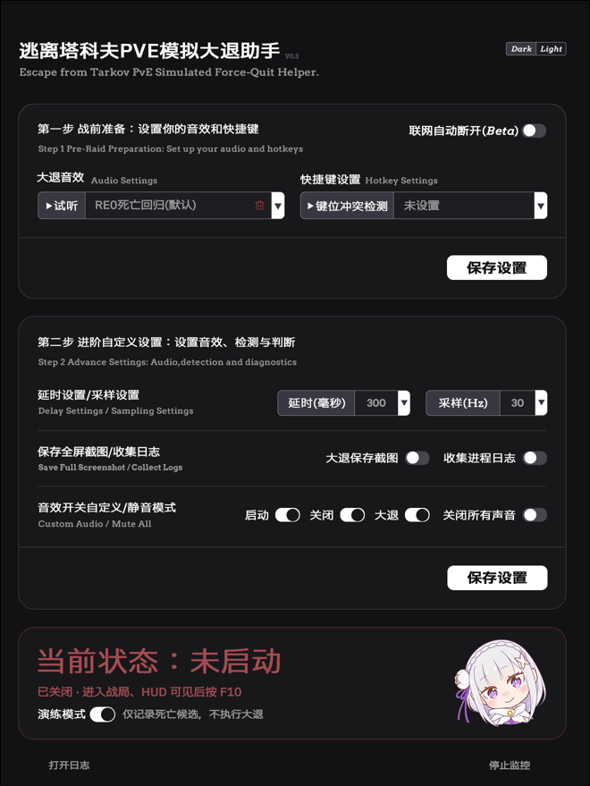
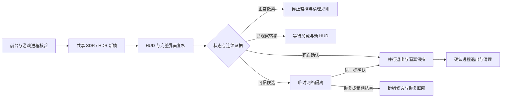

<div align="center">

# ID486 模拟助手


### V0.3 · 观察画面，自动响应

适用于本地PvE战局的一个大退(Alt F4)小工具


**[下载 V0.3](https://github.com/liudoge66/ID486-Tarkov-Assistant/releases/tag/v0.3)** · [快速使用](#快速使用) · [场景处理](#不同场景如何处理) · [技术方案](#当前技术方案) · [更新记录](docs/CHANGELOG.md)

</div>

---

进入战局、HUD 可见时按 **F10** 开始监控。助手结合 HUD、菜单、场景变化和可选的游戏日志线索判断状态；确认死亡后请求结束已核验的游戏进程，开启联网保险时并行隔离游戏及已核验的 UU 进程。正常撤离则停止监控并解除隔离。

V0.3 统一为一个版本，保留深浅主题、音效、快捷键、诊断和联网保险。**发行版已移除录像测试及 PyAV/FFmpeg 专用依赖**，不再区分 PMC / Fence 下载包。

## 使用前先确认

> **仅用于本地 PvE 战局。不要在“街区”地图使用：其默认线上模式不在本工具适用范围内。**

- 不读取游戏内存、不注入游戏、不修改游戏文件；判断来自屏幕画面及本机游戏日志。
- 大退与网络隔离不能承诺服务器回滚；已经送达的结算无法保证撤回。
- 演练模式不结束游戏进程；**如果同时开启联网保险，死亡判定仍可能隔离网络**。需要纯识别测试时，请保持联网保险关闭。
- 使用中文界面及已验证的 HUD 布局；不同语言、UI 缩放、分辨率和未知叠加层需要自行确认。4K HDR 已有本机实测，21:9 等布局的适配不代表所有显示组合均已验证。

<p align="center">
  
</p>

### UU 加速器设置

沿用现有使用要求：在“设置 → 加速设置”中关闭 **“解决本地 Hosts 文件域名冲突”** 和 **“加速时禁用网络代理”**。网络保险还依赖管理员授权及本机实际加速路径，以助手的就绪提示与日志确认为准。

<details>
<summary>查看 UU 设置位置</summary>


</details>

## 快速使用

1. 从 [Releases](https://github.com/liudoge66/ID486-Tarkov-Assistant/releases/tag/v0.3) 下载 **ID486-V0.3-Windows.zip**，解压到可写目录，运行 **ID486模拟助手.exe**。无需安装 Python。
2. 新用户默认进入演练模式。先关闭联网保险，在战斗 HUD 可见时按 **F10**，确认菜单、背包及撤离的处理符合预期。
3. 需要实际大退时关闭演练模式；需要联网保险时另行开启对应开关，并完成管理员授权。开关开启只是允许保险，按快捷键启动本轮监控后才进入待命。
4. 再按一次快捷键停止。死亡触发或正常撤离停机后，下一轮请在 HUD 可见时重新开启。

自定义音效支持 WAV / MP3 / FLAC / OGG；音量、快捷键、主题和高级设置均可保存。默认参数为 **300ms 确认延时、30Hz 采集目标频率**。确认延时不是端到端退出时限，采集频率也不等于完整检测频率。

## 不同场景如何处理

| 场景 | 当前处理 | 使用建议 |
|---|---|---|
| 普通战斗、暗房或光照变化，HUD 仍可识别 | 保持监控，不因画面暗就退出 | 正常使用 |
| HUD 消失并持续渐暗 | 在菜单、标题、转移等复核通过后，可走渐暗快速死亡分支 | 不保证每次都命中同一条分支 |
| HUD／菜单持续缺失，渐暗证据不足 | 按普通缺失路径累计有效观察；断档不全额计入死亡证据 | 总响应受分析负载与采集间隔影响 |
| 正常背包、ESC、设置、Steam 叠加层、BTR 对话 | 已识别的界面形成保护或暂停条件；恢复后继续 | 未覆盖的新界面仍需验证 |
| 正常撤离 | 跟踪倒计时接近结束，结合结构保持的渐暗及 HUD 消失确认；停止监控、清理规则 | 下一轮手动重新开启 |
| 正常地图转移 | 跟踪转移提示、旧 HUD 离场、加载和新 HUD 恢复；证据完整时自动续接 | 请尽量保持游戏前台直到恢复提示 |
| 已识别的显示设置切换、HDR／色彩配置变化 | 暂停相关判断或清空旧采集证据，等待新画面 | 持续无法确认时按提示重新开启 |
| 切出游戏／没有新帧 | 暂停判断，回到游戏后用新帧恢复；已有网络候选或保持状态按自身规则处理 | 不覆盖后台死亡，也不承诺恢复未观察到的整个过渡 |
| 联网助手异常或隔离确认失败 | 提示保护不可用或确认延迟；待命与最终死亡采用不同恢复策略 | 检查状态，必要时手动停止并重启保险 |

### 撤离／转移途中切屏

**这是当前最需要注意的使用边界。** 例如转移还剩二十秒时切出去，直到最后零点几秒或听见声音才切回来，助手可能错过倒计时、加载或 HUD 淡出的关键序列。

切回会恢复新帧观察，但无法补回没看到的过程，可能出现需要手动重新开启、继续等待、误判过渡或无法及时响应等结果。建议撤离和转移结束前保持游戏前台；如果已经错过过程，请以状态提示为准，确认回到可见战斗 HUD 后停止并重新开启。不要把“自动切回恢复”理解为所有撤离／转移时序都已恢复。

撤离结束瞬间的极端死亡与动画重叠情形仅作为少量特殊时序提示，不作为日常主要风险。

## 当前技术方案



| 层次 | 实现及作用 |
|---|---|
| 采集 | SDR 使用 DXGI；HDR 使用原生采集与色彩状态核验。共享不可变帧，带源帧时间、序号和采集代次，拒绝缓存、过期及跨配置画面。 |
| 视觉证据 | HUD 人形、快捷栏、标签等组合特征；菜单／背包／标题／Steam／BTR 复核。复用同帧投影和评分，减少重复计算。 |
| 渐暗 | 结构匹配渐暗、HSV 和 DarkTrend 多路径。DarkTrend 结合亮度分布、暗区扩大、分区下降及连续新帧，允许死亡镜头运动，仍需 HUD 缺失和当前界面复核。 |
| 状态机 | 实时判断共享统一策略，区分普通死亡、正常撤离、转移加载、设置切换和观察不确定；新帧 HUD／界面恢复可否决旧候选。 |
| 日志辅助 | 绑定本次游戏会话尾读 `/client/match/local/end`，处理轮转、半行和重复；新鲜日志可唤醒独立视觉复核，日志本身不直接授权退出。 |
| 退出 | 预先绑定核验过的游戏进程句柄，优先调用 TerminateProcess；请求失败时保留受控的窗口／快捷键备用路径，并分开记录请求、窗口消失和进程退出。 |
| 联网保险 | 原生 WFP 控制游戏及已核验的 UU 进程，覆盖 TCP/UDP、IPv4/IPv6。平时零隔离规则，预备资源；可信候选可先获得临时隔离，最终死亡转为保持。 |
| 保持与恢复 | 区分临时候选、结束请求保持、最终死亡保持；结束请求保持需明确正常反证和匹配 ACK 才解除，最终死亡保持不由普通 HUD 恢复解除。手动停止、游戏／助手退出及看门狗负责清理。 |
| 诊断 | 本地文本与 JSONL 日志，分别记录采集、判定、退出和联网 ACK；截图按选项保留，便于区分“请求成功”与“实际退出”。 |

## 测试与已知范围

V0.3 已完成本机实战测试，覆盖正常撤离、渐暗死亡、普通 HUD 缺失死亡、退出确认和联网规则清理；另有离线回归覆盖背包／菜单、转移、采集断档、焦点变化、倒计时、候选隔离和保持状态。

这些结果针对已测样本，不代表所有地图、语言、显示器与硬件均已验证。观察到结束请求不等于服务端保存成功；未观察到请求也不等于未发送。WFP 规则部署、连接授权拦截事件和服务器回滚是不同证据，不能相互替代。

## 本地数据与升级

- V0.3 在程序旁 **`数据`** 中保存设置、音效和日志；目录不可写时回退到 `%LOCALAPPDATA%\TarkovHUDMonitor\V0.3`。
- 默认关闭截图收集与详细性能日志，不自动上传用户数据。诊断可能包含游戏画面、路径、进程信息和监控期间的按键记录，分享前请检查。
- 从旧版升级时，若新数据目录尚无设置，会尝试迁移同目录的 `PMC数据`、`Fence数据` 或旧版根目录设置。建议保留旧目录备份，确认升级后再整理。
- 发布 ZIP 不包含私人设置、历史日志、诊断截图、录像或自定义音频；完整性见附件 **SHA256SUMS.txt**。

## 从源码构建

Windows x64、Python 3.11，运行：

```powershell
py -3.11 -m venv .venv
.\.venv\Scripts\python -m pip install -r scripts/requirements-build.txt
.\.venv\Scripts\python -m unittest discover -s tests
.\scripts\build.ps1
```

打包脚本自动编译原生联网助手，需要 Windows 自带的 .NET Framework C# 编译器。仓库附带 HDR 采集 DLL；其 Rust 源码、锁定依赖和重建方法位于 [src/native/hdr_capture](src/native/hdr_capture/BUILD.md)。构建不依赖开发者的旧目录，也不安装录像解码库。

## 权利与许可

非官方工具，与游戏开发商及素材权利人无隶属或授权关系。内嵌音效、字体、同人图像及第三方组件的权利归各自权利人；许可与来源见 [第三方许可说明](docs/THIRD_PARTY_NOTICES.md)、`docs/licenses`、`src/assets/capture` 及对应素材说明。
